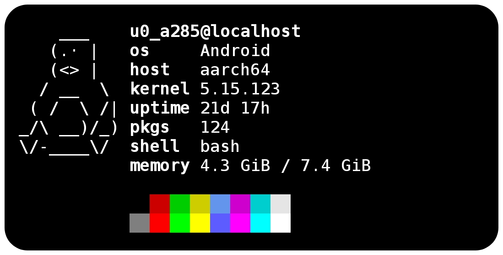

# t(ermux)fetch

**tfetch**: A tiny system info script for Termux, written in pure Bash.



## Table of Contents

- [Features](#features)
- [Installation](#installation)
- [Usage](#usage)
- [Examples](#examples)
- [Uninstallation](#uninstallation)
- [Environment](#environment)
- [Author](#author)
- [License](#license)

## Features

- Displays basic system information:
  - Username and hostname
  - OS, architecture, kernel
  - Uptime, installed packages, shell, memory
  - Current date and time
  - Color palette
- Works offline — no external dependencies
- Fast, lightweight, and silent on errors
- ASCII art included (tux, android and term)
- Use your own ASCII art from a file, or show no ASCII art at all
- Choose which info lines to show

## Installation

1. Clone the repository:
```bash
git clone https://github.com/haithamaouati/tfetch.git
```

2. Change to the tfetch directory:
```bash
cd tfetch
```

3. Install the script:
```bash
bash install.sh
```

## Usage

```bash
tfetch [OPTIONS]
```

### Options:

| Option | Long Form | Description |
|--------|-----------|-------------|
| `-c` | `--clear` | Clear the terminal screen before displaying info |
| `-p` | `--palette` | Show the terminal color palette |
|  | `--ascii` | Use a built-in ASCII art (default: tux) or a custom one from a text file |
|  | `--off` | Show the info without ASCII art |
| `-l` | `--layout` | Show the info beside (`side`, default) or below (`below`) the banner |
| `-d` | `--date` | Show the current date |
| `-t` | `--time` | Show the current time (hours, minutes, seconds) |
| `-a` | `--all` | Show all information, including `-d`, `-t`, and `-p` |
| `-C`| `--color` | Set bold color for info labels and, optionally, for the ASCII art: one or two values, each a 256-color index (0-255) or an SGR sequence such as "1;31" |
|  | `--disable` | Hide the given info lines |
| `-u` | `--update` | Update tfetch from the GitHub repository |
| `-v` | `--version` | Show the version and exit |
| `-h` | `--help` | Show this help message and exit |

### Examples

`​-c, --clear`

​Clear the terminal screen before displaying info.
```
tfetch --clear
```
`-p, --palette`

​Show the terminal color palette.
```
tfetch --palette
```
`--ascii NAME|FILE`

​Use a built-in ASCII art (`tux`, `android` or `term`; default: tux) or a custom one from a plain text file. A file with 7 lines is shown beside the info, any other size is shown above it. Short lines are padded and color codes are removed (use `-C` to color it). If a file has the same name as a built-in one, write it as `./tux`.
```
# Built-in ASCII art
tfetch --ascii android

# Custom ASCII art from a file
tfetch --ascii path/to/ascii.txt
```
`--off`

​Show the info without ASCII art.
```
tfetch --off
```
`-l, --layout NAME`

​Show the info beside (`side`, default) or below (`below`) the banner.
```
tfetch --layout below
```
`-d, --date`

​Show the current date.
```
tfetch --date
```
`-t, --time`

​Show the current time (hours, minutes, seconds).
```
tfetch --time
```
`-a, --all`

​Show all information, including `-d`, `-t`, and `-p`.
```
tfetch --all
```
`-C, --color COLOR [COLOR]`

​Set the bold color of the info labels, and optionally of the ASCII art, using a 256-color index (`0-255`) or an SGR sequence (e.g., `"1;31"`). The first value is for the info labels and the second one, if given, is for the ASCII art, which is then bold too.
```
# Using a 256-color index (e.g., 208 for bright orange)
tfetch --color 208

# Using an SGR sequence (e.g., "1;31" for bold red)
tfetch -C "1;31"

# Labels in green, ASCII art in blue
tfetch -C 32 34
```
`--disable NAME...`

​Hide the given info lines. Names can be separated by spaces or commas: `title`, `os`, `host`, `kernel`, `uptime`, `pkgs`, `shell`, `memory`, `date` and `time`.
```
tfetch --disable os memory
```
`-u, --update`

​Update tfetch from the GitHub repository.
```
tfetch --update
```
`-v, --version`

​Show the version and exit.
```
tfetch --version
```
`-h, --help`

​Show the help message and exit.
```
tfetch --help
```

### Make it a Startup Banner (Optional)

1. Open `~/.bashrc` using `nano`:
```bash
nano ~/.bashrc
```

2. Add the following line at the end of the file:
```bash
tfetch -c -C 35 -d -p
```

3. Save and exit using `Ctrl` + `X`, then press `Y` and `Enter`

## Uninstallation

```bash
bash uninstall.sh
```

## Environment

- **Tested on:** [Termux](https://termux.dev/en/)

## Author

Made with :coffee: by **Haitham Aouati**
  - GitHub: [github.com/haithamaouati](https://github.com/haithamaouati)
  - Telegram: [t.me/haithamaouati](https://t.me/haithamaouati)

### Find this repository useful? ♥️

Support it by joining the [stargazers](https://github.com/haithamaouati/tfetch/stargazers). ⭐

If you want to help even more, please spread the word — share the project on X, Reddit, or with your community so more people discover it.

And [follow me](https://github.com/haithamaouati) to keep up with future updates and projects. 🤩

## License

**tfetch** is licensed under [MIT license](LICENSE)
