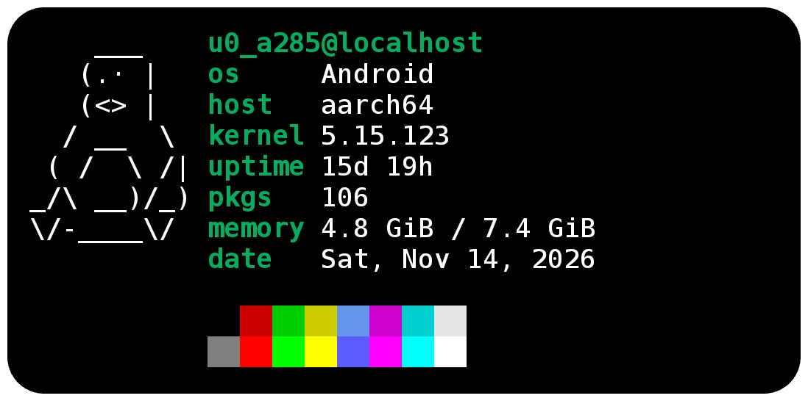

# t(ermux)fetch

[](https://www.madeinalgeria.dev/projects/tfetch)

**tfetch**: A tiny system info script for Termux, written in pure Bash.



## Table of Contents

- [Features](#features)
- [Installation](#installation)
- [Usage](#usage)
- [Examples](#examples)
- [Uninstallation](#uninstallation)
- [Environment](#environment)
- [Author](#author)
- [License](#license)

## Features

- Displays basic system information:
  - Username and hostname
  - OS, architecture, kernel
  - Uptime, installed packages, memory
  - Current date and time
  - Color palette
- Works offline — no external dependencies
- Fast, lightweight, and silent on errors
- ASCII art included (tux, android and term)

## Installation

1. Clone the repository:
```bash
git clone https://github.com/haithamaouati/tfetch.git
```

2. Change to the tfetch directory:
```bash
cd tfetch
```

3. Install the script:
```bash
bash install.sh
```

## Usage

```bash
tfetch [OPTIONS]
```

### Options:

| Option | Long Form | Description |
|--------|-----------|-------------|
| `-c` | `--clear` | Clear the terminal screen before displaying info |
| `-p` | `--palette` | Show the terminal color palette |
| `-b` | `--banner` | Choose the ASCII art banner (default: tux)|
| `-d` | `--date` | Show the current date |
| `-t` | `--time` | Show the current time (hours, minutes, seconds) |
| `-a` | `--all` | Show all information, including `-d`, `-t`, and `-p` |
| `-C`| `--color` | Set bold color for info labels: a 256-color index (0-255) or an SGR sequence such as "1;31" |
| `-A` | `--art-color` | Also apply the `-C` color to the banner |
| `-v` | `--version` | Show the version and exit |
| `-h` | `--help` | Show this help message and exit |

### Examples

`​-c, --clear`

​Clear the terminal screen before displaying info.
```
tfetch --clear
```
`-p, --palette`

​Show the terminal color palette.
```
tfetch --palette
```
`-b, --banner NAME`

​Choose the ASCII art banner (default: tux).
```
tfetch --banner android
```
`-d, --date`

​Show the current date.
```
tfetch --date
```
`-t, --time`

​Show the current time (hours, minutes, seconds).
```
tfetch --time
```
`-a, --all`

​Show all information, including `-d`, `-t`, and `-p`.
```
tfetch --all
```
`-C, --color VALUE`

​Set bold color for info labels using a 256-color index (`0-255`) or an SGR sequence (e.g., `"1;31"`).
```
# Using a 256-color index (e.g., 208 for bright orange)
tfetch --color 208

# Using an SGR sequence (e.g., "1;31" for bold red)
tfetch -C "1;31"
```
`-A, --art-color`

​Also apply the `-C` color to the banner.
```
tfetch --color 208 --art-color
```
`-v, --version`

​Show the version and exit.
```
tfetch --version
```
`-h, --help`

​Show the help message and exit.
```
tfetch --help
```

### Make it a Startup Banner (Optional)

1. Open `~/.bashrc` using `nano`:
```bash
nano ~/.bashrc
```

2. Add the following line at the end of the file:
```bash
tfetch -c -p
```

3. Save and exit using `Ctrl` + `X`, then press `Y` and `Enter`

## Uninstallation

```bash
bash uninstall.sh
```

## Environment

- **Tested on:** [Termux](https://termux.dev/en/)

## Author

Made with :coffee: by **Haitham Aouati**
  - GitHub: [github.com/haithamaouati](https://github.com/haithamaouati)
  - Telegram: [t.me/haithamaouati](https://t.me/haithamaouati)

### Find this repository useful? ♥️

Support it by joining the [stargazers](https://github.com/haithamaouati/tfetch/stargazers). ⭐

If you want to help even more, please spread the word — share the project on X, Reddit, or with your community so more people discover it.

And [follow me](https://github.com/haithamaouati) to keep up with future updates and projects. 🤩

## License

**tfetch** is licensed under [WTFPL license](LICENSE)
